# Parcours complet du dossier — propositions UX/UI en mode clair

22 octobre 2026. Maquettes de conception, données fictives. Aucun code applicatif modifié par cette intervention et aucune opération métier enregistrée pendant les contrôles. Génération par l’outil ImageGen intégré, puis sélection et corrections visuelles.

## Comment lire ce parcours

Les écrans couvrent un dossier depuis sa création jusqu’au suivi après prestation, avec les consultations imbriquées. Ce n’est pas un assistant imposant un ordre : conception, administration, équipe, hébergement et transport peuvent avancer en parallèle. Les valeurs des images représentent des exemples à différents moments et ne forment pas une base cohérente de calcul.

Le périmètre est le dossier et ses relations directes. Les formulaires annexes sont indiqués dans la cartographie ; cela ne prétend pas inventorier chaque écran de l’ancien système ni prouver une parité complète. Les parcours contrats/frais/règlements restent accessibles depuis les personnes et contrats concernés et nécessitent leur propre dossier UX détaillé.

## Structure commune proposée

- Synthèse : informations, points à compléter, accès directs.
- Conception : budget, mode, tableaux, lignes, modèles/copies et documents associés.
- Organisation : équipe, hébergement, transport, batteries liées au camion et feuille de route.
- Préparation : ramassage, fabrication et cycle physique, accessoires.
- Documents : pièces, préparation préfectorale et PDF générés.
- Suivi : rapport de tir, commentaires et historique.

C’est un regroupement de navigation, pas une suppression des fonctions. Les actions secondaires, champs rares, états, archives et réouvertures restent disponibles selon les droits. Les grands tableaux gardent pagination et défilement propres. Les formulaires courts ne s’étalent pas inutilement ; les documents/tableaux denses peuvent s’agrandir.

## Règles des formulaires et données croisées

1. Distinguer trois objets : **fiche commune** (personne, hôtel, produit), **relation** (affectation, nuitée, quantité camion), **document ou événement**. Le titre et le bouton d’enregistrement nomment exactement l’objet modifié.
2. Ne pas limiter arbitrairement les parcours à deux ou trois fenêtres. Conserver la pile complète et rendre son chemin lisible ; replier les ancêtres si nécessaire, mais ne pas les perdre. Un seul formulaire est actif et accessible au clavier à la fois.
3. « Revenir à la nuitée », « Revenir au produit », etc. ferme une couche. Un saut vers un ancêtre vérifie chaque brouillon abandonné. La fermeture de la recherche ne ferme aucun formulaire.
4. Chaque formulaire conserve son brouillon pendant les consultations liées. Enregistrer un enfant ne sauvegarde pas les parents. Une modification de fiche partagée reste distincte d’une modification du lien au dossier.
5. Rafraîchir le libellé d’une fiche modifiée sans effacer la saisie du parent. Si un lien devient invalide ou archivé, expliquer et demander une nouvelle sélection selon la règle existante ; ne pas le remplacer en silence.
6. Erreur : message près du champ, saisie conservée, résumé cliquable si plusieurs erreurs. Conflit : refuser l’écrasement et laisser consulter la dernière valeur sans perdre le brouillon.
7. Clavier : focus dans le panneau actif, ordre logique, retour au bouton qui l’a ouvert. Échap ferme un niveau ; demander avant abandon si modifié. Aucun raccourci monocaractère ne s’active pendant une saisie.
8. Les actions sur fiche partagée indiquent leur portée. Consultation, sélection, création, modification et retrait de lien ne sont pas interchangeables. Un bouton « Voir » ne modifie rien.
9. Décliner la même structure en clair, sombre et système ; cette livraison illustre le mode clair. Mesurer les contrastes et vérifier le focus lors de l’implémentation.
10. Les informations métier restent visibles ; les info-bulles ajoutent des précisions et sont accessibles au focus. Elles ne portent ni une erreur obligatoire ni la seule explication d’un blocage.

## Cartographie des imbrications

| Point de départ | Chaîne conservée ou proposée | Objet modifié / retour |
| --- | --- | --- |
| Dossier en cours | Client → Contacts → Contact → Poste | Contact commun au client, puis retour au dossier. Consultation directe du poste proposée. |
| Ligne de conception | Catalogue → Produit → Groupe ou Dépôt → Modifier référentiel | Fiche commune, puis retour au produit/catalogue et à la ligne. |
| Équipe | Affectation → Personne → Diplômes / Contrat | L’affectation et le profil sont distincts. |
| Équipe | Affectation → Hébergement du dossier → Nuitée → Hôtel | Revenir à chaque formulaire sans effacer la demande d’hôtel ni les autres valeurs. |
| Nuitée | Personnes sélectionnées → Profil | Consultation publique selon les droits ; données privées protégées. |
| Camion | Dossiers sélectionnés → Dossier → Client | Retour au camion ; aucune réaffectation implicite. |
| Camion | Matériel → Quantité OU fiche matériel → Modification | Quantité du lien distincte du comptage global. |
| Camion | Loueur / Chauffeur → Fiche | Consultation dans le contexte, droits recontrôlés. |
| Camion | Batteries → Quantité préparée → Stock batteries | Besoin calculé, préparation et stock distincts. |
| Préfecture | Chef responsable → Profil → F4 / Agrément | Retour à la déclaration et conservation des notes. |
| Feuille de route | Personne / Camion / Nuitée | Revenir à la même feuille et au même jour. |
| Document | Fichier → Versions / Archive | Historique conservé, droits de téléchargement distincts. |

## Vérifications effectuées dans le prototype actuel

Ces vérifications manuelles sont datées de cette session. Aucun test ancien n’est présenté comme réexécuté et aucune suite automatisée complète n’a été lancée.

| Contrôle | Résultat courant | Limite |
| --- | --- | --- |
| Liste → recherche DOS-2026-1999 → fiche | Référence retrouvée ; le contexte de recherche est porté par le lien de retour | Pagination/défilement complets non rejoués |
| Modifier dossier → saisir une note → Fiche client | **Échec d’ouverture** ; la note reste visible dans le parent | Erreur UI générique. Journal local : permission client-documents.view manquante. Aucun correctif appliqué |
| Ligne → quantité provisoire 7 → Produit → Groupe → Modifier groupe | **Quatre niveaux ouverts** | Aucun enregistrement ; pas de test des conflits de mises à jour |
| Retour Référentiel → Groupe → Produit → Ligne | **Quantité 7 conservée** ; remise à 2 puis fermeture sans sauvegarde | Persistance après fermeture/rechargement non promise |
| Camion TRA-DEMO-01 → Matériel MAT-DEMO-01 → Quantité | **Formulaire du lien ouvert**, valeur 2, annulation sans modification | Aucun changement du stock ou quantité exécuté |
| Recherche globale DOS-2026-1999 | **Aucun résultat**, alors que la recherche de liste retrouve le dossier | Périmètre/indexation exacts à diagnostiquer ; pas de promesse de recherche globale fonctionnelle |
| Équipe du dossier 1999 | Consultation accessible, aucune personne affectée dans ce jeu | Imbrication profil/hôtel/contrat non rejouée |
| Abandon du brouillon dossier | Le formulaire a fini par se fermer sans sauvegarde | Le contrôle navigateur n’a pas permis de qualifier proprement la confirmation native ; ne pas déclarer ce test réussi |
| Échap dans la recherche globale | Commande envoyée ; pas de résultat sélectionnable pour tester Entrée | Fermeture visuelle/focus pas qualifiés, pas de validation clavier complète |

Preuves actuelles : dossier `preuves/`. La capture 01 montre la note conservée après échec ; la notification s’était déjà fermée au moment de la capture. Le texte d’erreur est attesté par le DOM observé et le journal, pas par une notification visible sur cette image.

## Vérification de conception des nouvelles maquettes

Contrôle effectué : couverture des rubriques métier lues, séparation fiche/lien, présence des retours, lisibilité générale, mode clair et corrections de navigation/champs facultatifs. Ce contrôle visuel n’est pas un test fonctionnel.

Points de dessin à ne pas transformer en règles : quelques compteurs, badges, quantités et noms sont illustratifs ; la liste présente un filtre et des résultats non strictement cohérents ; certaines images conservent des pictogrammes de nouvel onglet alors que l’intention est un panneau interne ; quelques onglets actifs ou sous-titres varient. La structure commune ci-dessus et les champs/règles du code priment. Les compteurs de caractères dessinés ne fixent pas les limites actuelles des champs. Les salaires et données privées sont conditionnés aux droits. Les valeurs d’exemple entre écrans ne prouvent aucun calcul de stock, disponibilité, poudre ou conformité.

## Recette UX à effectuer après implémentation

- Rejouer toutes les chaînes ci-dessus, avec et sans modifications de chaque formulaire parent/enfant.
- Enregistrer un enfant, annuler un enfant, fermer par croix/Échap, sauter un ancêtre, ouvrir une seconde branche ; vérifier exactement les données et le focus au retour.
- Vérifier recherche globale par référence/nom/client/produit, absence de résultat, erreur, résultats limités aux droits ; raccourcis Mac et Windows et absence de conflits dans les champs.
- Tester les vues enregistrées, leurs colonnes et filtres, les droits et le retour liste/page/défilement.
- Déclencher erreurs de saisie et conflit à deux utilisateurs, lien devenu invalide/archivé, droits retirés et traitement PDF en échec.
- Contrôler clavier, lecteur d’écran, zoom 200 %, contrastes mesurés, ordinateur portable, tablette et mobile. Tester les deux thèmes avec la même information.
- Valider les termes et les tâches avec secrétariat, conception, atelier et responsable. Mesurer le temps et les erreurs sur un scénario métier réel avant/après.

## Sources locales consultées

DossierResource.php, ClientPanel.php, ClientFields.php, ContactPanels.php, DirectoryFields.php, DesignFields.php, CatalogFields.php, PanelLayout.php, DossierNavigation.php, CrewEditor.php, StaffFields.php, LodgingFields.php, TransportFields.php, PickingEditor.php, PreparationEditor.php, AccessoryBoxEditor.php, BatteryEditor.php, RouteSheetEditor.php, RouteSheet.php, ShootingReportEditor.php, vues du dossier ; registre docs/suivi-fonctionnalites.json et rapports de validation associés. Les rapports anciens donnent le contexte, pas une preuve de passage courant.

## Les écrans, étape par étape

### 01. Accueil

**Objectif :** Commencer sa journée.

**Chemin :** Accueil → À traiter → action du dossier.

**Données et fonctions :** Priorités du jour, prestations à venir, dossiers récents. Le profil détermine les informations proposées.

**Existant / proposition :** La vue d’ensemble existe ; les priorités agrégées, récents et favoris sont proposés.

**Règle à conserver :** Ouvrir directement la bonne rubrique du dossier. Aucun compteur ne doit présenter une donnée inconnue comme zéro.

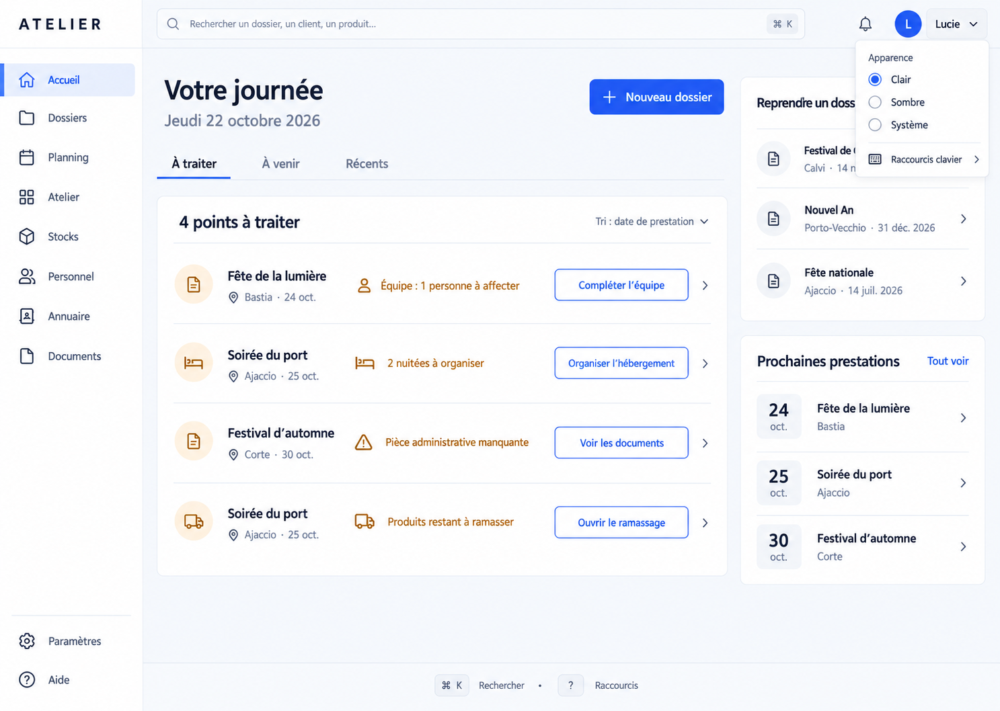

### 02. Recherche et commandes

**Objectif :** Trouver une information sans parcourir les menus.

**Chemin :** Recherche → résultats classés → aperçu ou fiche.

**Données et fonctions :** Recherche par référence, client, lieu et produit ; résultats contextualisés ; commandes accessibles selon les droits.

**Existant / proposition :** La recherche globale est visible, mais ne retrouve pas la référence DOS-2026-1999 dans le test courant. Le dialogue enrichi et les commandes sont proposés.

**Règle à conserver :** ⌘ K / Ctrl K : ouvrir. Flèches : parcourir. Entrée : ouvrir. Échap : fermer seulement la recherche. Une navigation avec un brouillon exige une décision explicite ; fermer la recherche ne doit pas perdre le formulaire.

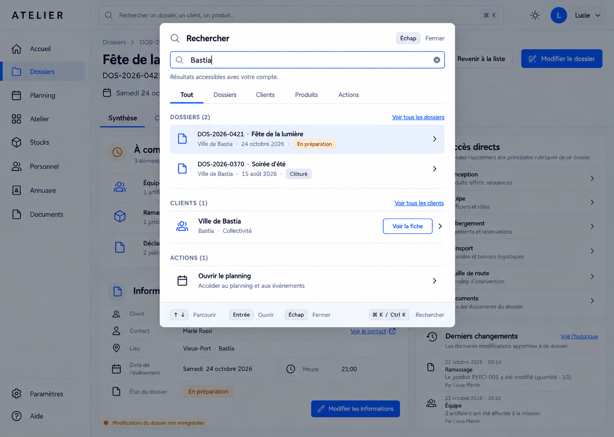

### 03. Liste et aperçu

**Objectif :** Retrouver et consulter le dossier.

**Chemin :** Dossiers → recherche/filtres → aperçu → fiche complète → retour.

**Données et fonctions :** Référence, intitulé, client, prestation, état ; filtres client/état/période ; tri, pagination et contexte.

**Existant / proposition :** Liste et aperçu présents. Vues nommées, choix des colonnes et favoris proposés.

**Règle à conserver :** Retour à la recherche, aux filtres, à la page et au défilement. Attention : les exemples de résultats et certains badges de l’image sont indicatifs ; les quatre états administratifs restent Brouillon, En préparation, Prêt et Clôturé.

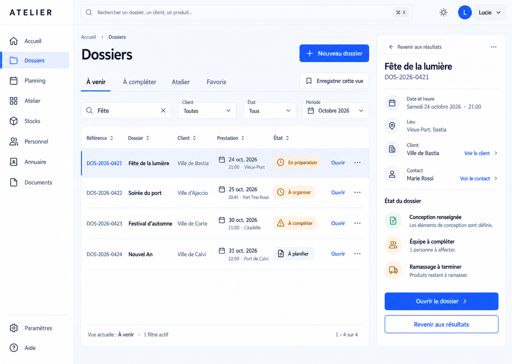

### 04. Créer le dossier

**Objectif :** Enregistrer les informations initiales.

**Chemin :** Nouveau dossier → client/contact → organisation prévisionnelle → créer.

**Données et fonctions :** Référence, intitulé, client et état obligatoires. Contact du dossier, date, heure, lieu et notes facultatifs. Création depuis un modèle selon les droits. Organisation : un à cinq jours, besoins par jour.

**Existant / proposition :** Champs et création depuis un modèle présents ; disposition et raccourcis de consultation proposés.

**Règle à conserver :** Les besoins ne créent pas d’affectations. Le choix d’un autre client remet le contact à sélectionner. Échec de validation : conserver la saisie. Les champs de besoins restent validés selon les règles actuelles, même si la maquette présente la section comme optionnelle.

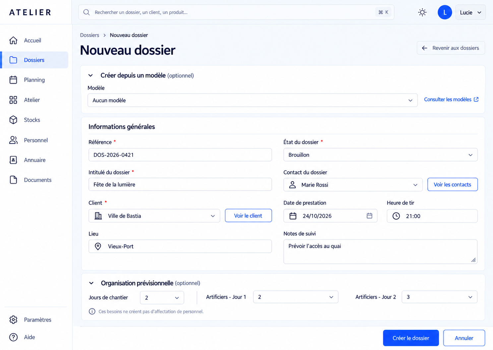

### 05. Synthèse du dossier

**Objectif :** Comprendre l’état du travail.

**Chemin :** Dossier → Synthèse → point à compléter → bonne rubrique.

**Données et fonctions :** Informations générales, état administratif, liens client/contact ; accès à toutes les fonctions actuelles.

**Existant / proposition :** Synthèse présente ; agrégation des manques et derniers changements proposée.

**Règle à conserver :** Les manques ne sont pas de nouveaux états administratifs ni une certification. L’absence de besoin, une valeur inconnue et zéro sont distincts.

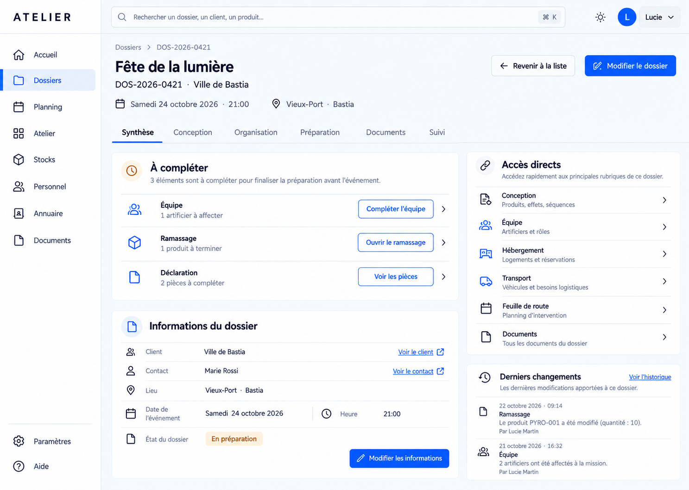

### 06. Client et contact imbriqués

**Objectif :** Consulter et corriger une donnée liée pendant une saisie.

**Chemin :** Modifier dossier → Fiche client → Contacts liés → Modifier le contact → retours successifs.

**Données et fonctions :** Client : identité libre/structurée, coordonnées, catégorie, adresses, notes. Contact : identité, poste, fonction, e-mail, téléphones, adresses, actif.

**Existant / proposition :** Chaîne présente dans le code et les anciens rapports. Test courant bloqué dès Fiche client par le droit client-documents.view manquant. Ce parcours n’est donc pas validé de bout en bout aujourd’hui.

**Règle à conserver :** Sauver le contact ne sauve pas le dossier. Le contact appartient au client ; sa sélection dans un dossier est un lien distinct. La consultation directe du poste et certains boutons Voir près des champs sont des propositions, pas des fonctions démontrées dans ce test.

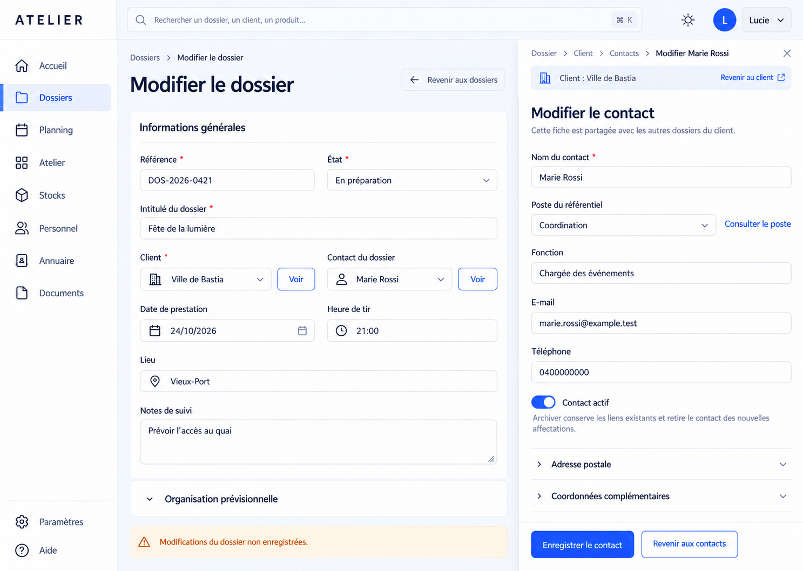

### 07. Concevoir le spectacle

**Objectif :** Construire les tableaux et leurs lignes.

**Chemin :** Conception → tableau → ligne → catalogue ou produit → retour → enregistrer la ligne.

**Données et fonctions :** Mode séquentiel/musical, budget, tableaux, numéros de groupe, produit, quantité, allumeurs, chapelets, retards ; tops départ/fin en mode musical. Copie et modèles conservés.

**Existant / proposition :** Éditeur, champs et consultations liés présents. Ouverture d’une ligne effectivement vérifiée.

**Règle à conserver :** Dans le test, quantité enregistrée 2, saisie provisoire 7 ; les cumuls enregistrés ne changent pas avant sauvegarde. Les groupes simultanés gardent leurs règles. Une indisponibilité d’édition après lancement doit rester expliquée.

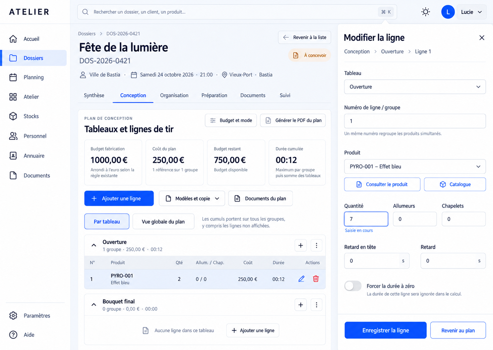

### 08. Produit, groupe et formulaire lié

**Objectif :** Aller jusqu’à un référentiel puis retrouver la ligne en cours.

**Chemin :** Ligne → Produit → Groupe → Modifier le groupe → Groupe → Produit → Ligne.

**Données et fonctions :** Produit, identification commerciale/technique, stock physique, groupe et dépôt ; formulaire du référentiel code/libellé/activité.

**Existant / proposition :** Chaîne à quatre niveaux parcourue dans le navigateur. Retour à la ligne avec la quantité 7 confirmé. Aucun enregistrement effectué.

**Règle à conserver :** La fiche partagée, sa relation au produit et la ligne du dossier sont trois objets distincts. Le fil complet reste visible. L’image illustre le brouillon ; la ligne enregistrée du test reste à 2. Ne pas déduire un recalcul du budget depuis cette image.

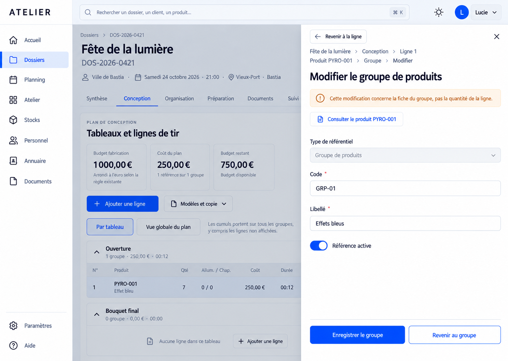

### 09. Préparation administrative

**Objectif :** Rassembler les informations et les pièces préfectorales.

**Chemin :** Documents → Déclaration → contact/chef → profil et pièces → retour → ZIP.

**Données et fonctions :** Contact client, chef responsable choisi parmi les chefs du dossier, diplôme F4, agrément, CERFA, schéma, documents annuels, plan associé, distances et pièces manquantes.

**Existant / proposition :** Fonctions décrites dans le prototype et ses rapports ; ce parcours n’a pas été rejoué dans cette session.

**Règle à conserver :** Préparer un ZIP ne signifie pas transmettre une déclaration ni obtenir une autorisation. Le responsable n’est pas remplacé automatiquement. Les pièces présentes ne prouvent pas leur validité. Le compteur de l’image est illustratif et doit correspondre aux pièces réellement manquantes.

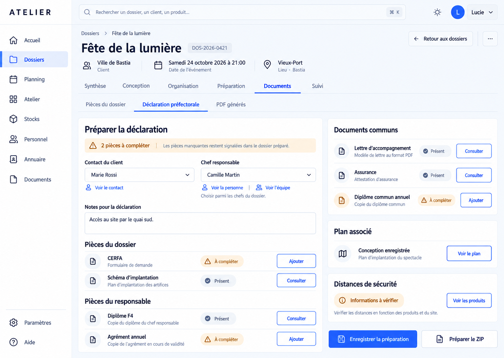

### 10. Affecter les personnes

**Objectif :** Modifier le lien personne–dossier–jour.

**Chemin :** Organisation → Équipe → Affectation → Profil / Hébergement / Contrat → retour.

**Données et fonctions :** Personne, jour, rôle, statut, partage, demande d’hôtel et salaire net selon les droits. Déplacer et intervertir restent disponibles dans les actions secondaires.

**Existant / proposition :** Équipe et formulaires présents ; équipe du dossier 1999 consultée mais sans personne affectée. Enregistrement, déplacement et interversion non rejoués.

**Règle à conserver :** Le profil est commun ; rôle, salaire, statut et hébergement appartiennent à l’affectation. La demande d’hôtel n’est pas une réservation. Le salaire conserve sa nature métier ; le mot indicatif dans l’image ne change pas sa règle. Le lien contrat n’apparaît que s’il existe.

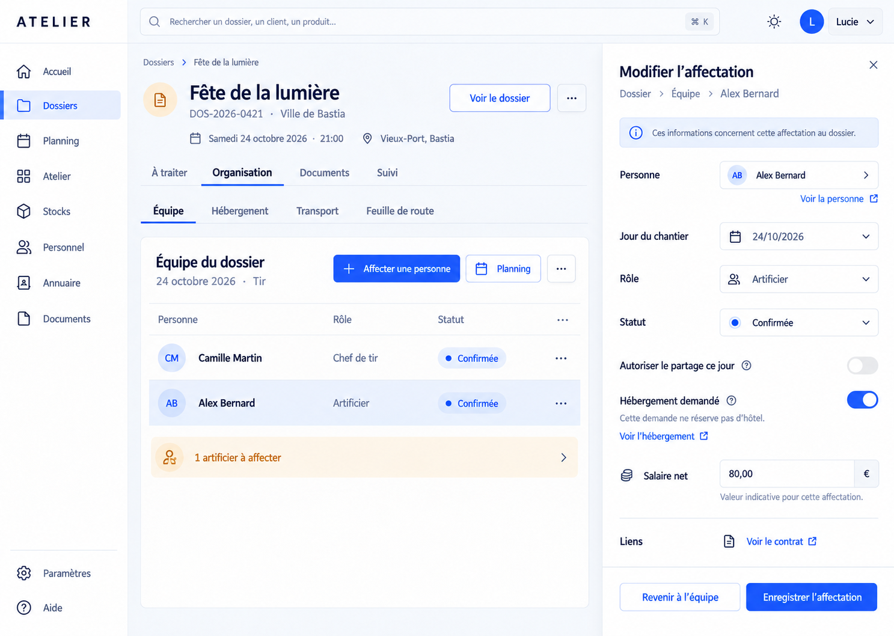

### 11. Planning transversal

**Objectif :** Répartir les personnes dans le temps.

**Chemin :** Planning → personne/jour → affectation du dossier → retour à la même semaine.

**Données et fonctions :** Préparation et tir, jour, personne, rôle et statut ; filtres et accès au dossier.

**Existant / proposition :** La liste hebdomadaire existe. La grille calendrier illustrée est proposée et n’a pas été implémentée.

**Règle à conserver :** Une présence sur plusieurs dossiers le même jour n’est pas automatiquement un conflit : respecter le partage et les contrôles existants. Les affectations de cette ancienne image sont des exemples indépendants ; elles ne constituent pas l’effectif de référence du dossier exemple.

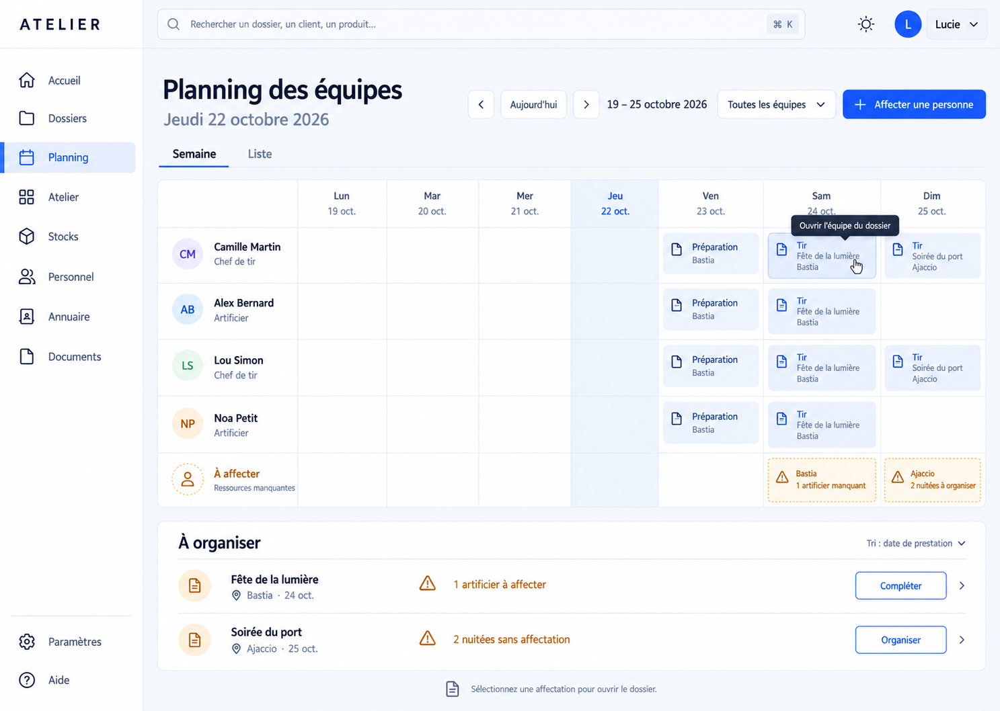

### 12. Hôtel et nuitée

**Objectif :** Affecter les personnes à une nuitée et consulter l’hôtel.

**Chemin :** Hébergement → Nuitée → Hôtel → Modifier hôtel → retour ; ou Personnes → Profil → retour.

**Données et fonctions :** Date de nuitée, hôtel, personnes, coût total de l’affectation et commentaires. Date/dossier fixes après création. Éligibilité et doublons selon les règles existantes.

**Existant / proposition :** Chaînes présentes dans LodgingFields ; pas de test navigateur de ce parcours pendant cette session.

**Règle à conserver :** Enregistrer l’hôtel ne réserve rien et ne sauvegarde pas la nuitée. Le coût est total pour l’affectation, pas un tarif par personne. Le compteur 0 besoin non affecté est à présenter sans couleur d’alerte.

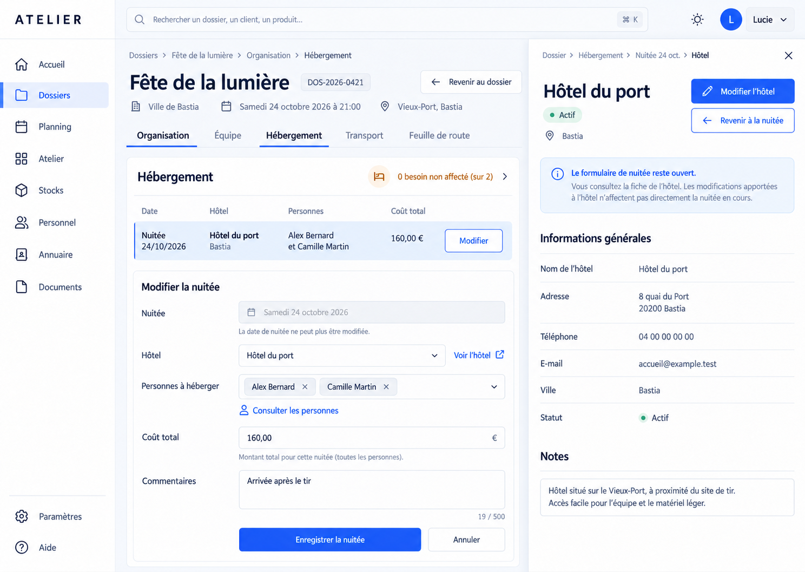

### 13. Ramasser les produits

**Objectif :** Saisir le total pris pour le dossier.

**Chemin :** Préparation → Ramassage → Produit → total → mouvements liés → retour.

**Données et fonctions :** Quantité prévue, stock réel, total ramassé, note ; consultation produit et mouvements.

**Existant / proposition :** Champs/règles vérifiés dans PickingEditor ; aucune opération de stock exécutée ici.

**Règle à conserver :** Exemple : 4 déjà ramassés, nouveau total 7 = 3 supplémentaires ; réduire le total réintègre la différence. L’aperçu du delta avant enregistrement est une amélioration UX proposée. Aucune nouvelle déduction à la fabrication.

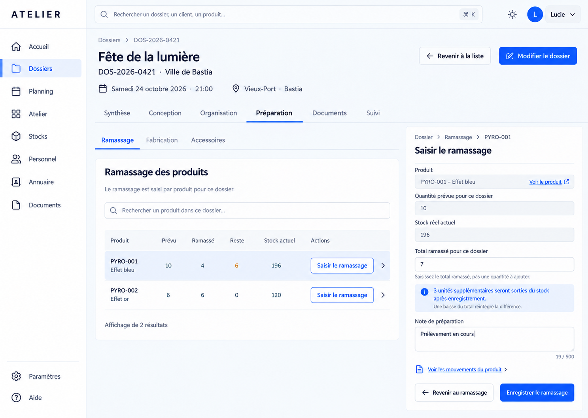

### 14. Fabrication et cycle physique

**Objectif :** Suivre les lignes et les étapes physiques du feu.

**Chemin :** Fabrication → ligne → Grappé/Carton → retour ; Changer d’étape → dépôt/sortie/retour.

**Données et fonctions :** Lancement et retrait du lancement selon les gardes, grappage, mise en carton, stockage, sorties/retours et historique physique. Fiche fabrication et document transport.

**Existant / proposition :** Fonctions présentes, règles et champs relus ; écritures et transitions non exécutées dans cette session.

**Règle à conserver :** Carton implique grappage. Le cycle physique est distinct de l’état administratif. Annuler conserve le feu au dépôt et ne recrédite pas automatiquement le stock produit. Le retour au brouillon suit les contrôles existants.

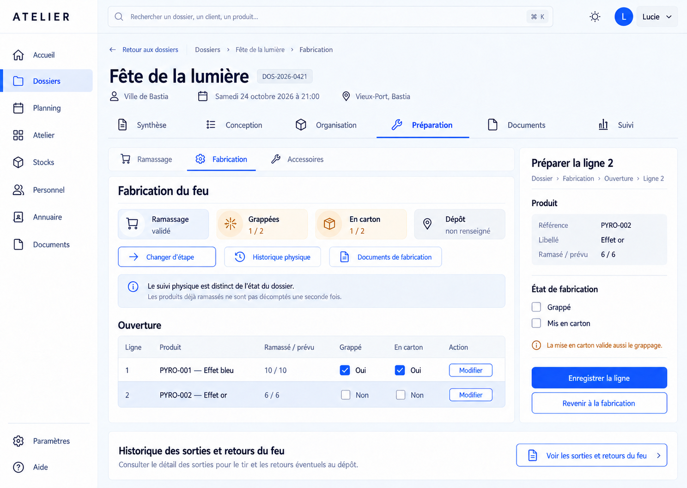

### 15. Carton d’accessoires

**Objectif :** Calculer, ajuster puis valider le carton.

**Chemin :** Accessoires → calcul explicite → catégorie → quantités → validation / réouverture.

**Données et fonctions :** Catégorie de chandelles, allumeurs, Scotchlok, Rilsan et autres accessoires ; ajustements manuels, PDF et verrouillage indépendant.

**Existant / proposition :** Actions de calcul, modification et validation relues dans AccessoryBoxEditor ; non exécutées.

**Règle à conserver :** Le recalcul remplace seulement trois quantités, y compris leurs ajustements manuels ; les neuf autres sont conservées. Aucun mouvement produit. L’aperçu avant confirmation est proposé. La validation bloque les quantités jusqu’à réouverture, sans valider le reste du dossier.

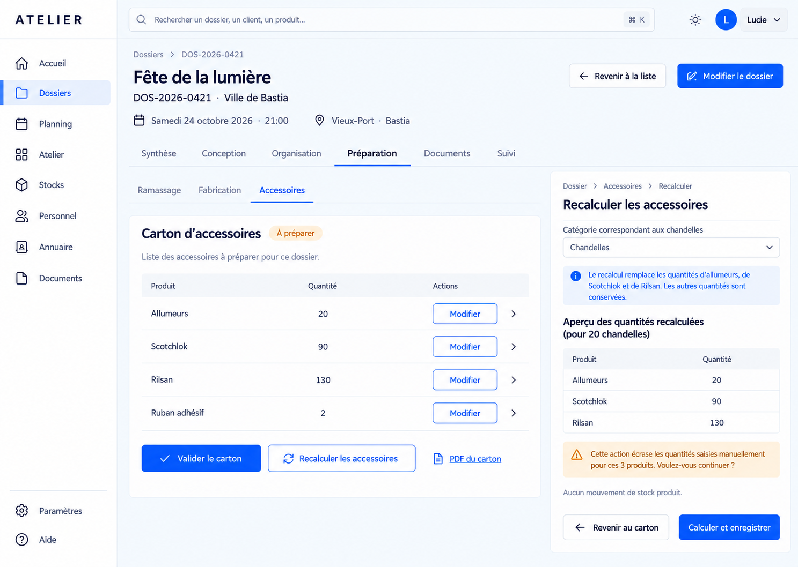

### 16. Camions et matériel lié

**Objectif :** Modifier une quantité de matériel propre au camion.

**Chemin :** Dossier → Transport → Camion → Matériel → Quantité ou Fiche → retour.

**Données et fonctions :** Plusieurs camions par dossier, plusieurs dossiers par camion ; loueur, chauffeurs, dates de prise/retour/réservation/début location, matériel annexe.

**Existant / proposition :** TRA-DEMO-01 ouvert, deux dossiers liés consultables, formulaire quantité MAT-DEMO-01 ouvert avec valeur 2 puis annulé sans modification.

**Règle à conserver :** La quantité appartient au camion : ni somme/max automatique des dossiers ni décompte du stock global. Validation/réouverture, archivage/restauration conservés. Les dates de location restent distinctes du tir. L’onglet parent doit être Organisation, même si l’image souligne Préparation par erreur.

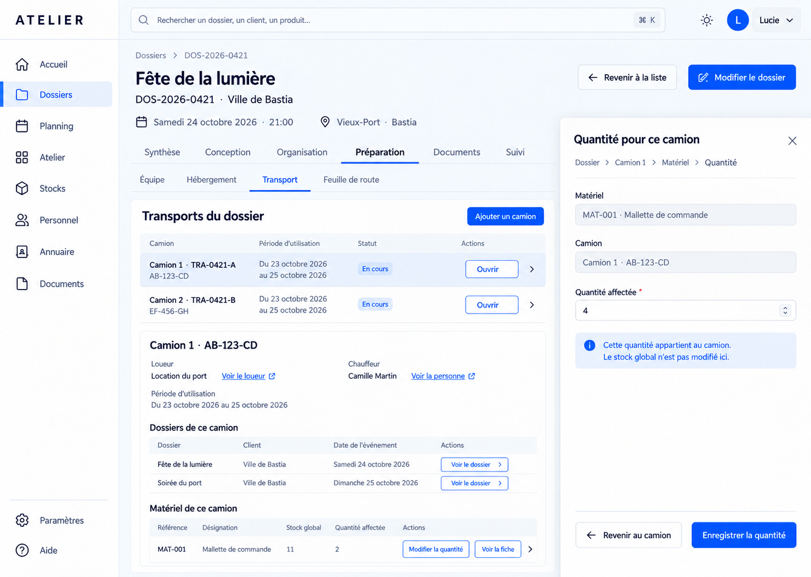

### 17. Batteries de tir

**Objectif :** Distinguer les besoins calculés et la préparation enregistrée.

**Chemin :** Camion → Calcul batteries → Préparation → Ajuster → Stock / Document → retour.

**Données et fonctions :** Types, catégories, calibres, quantités calculées/préparées, revue, validation et réouverture.

**Existant / proposition :** BatteryEditor relu ; pas de test fonctionnel ou d’écriture sur ce module pendant la session.

**Règle à conserver :** Un recalcul automatique n’est pas une règle générale pour un camion multi-dossiers. La revue manuelle actuelle reste nécessaire dans les cas prévus. La validation ne réserve ni ne décompte de stock. Les chiffres du dessin ne sont pas un calcul homologué.

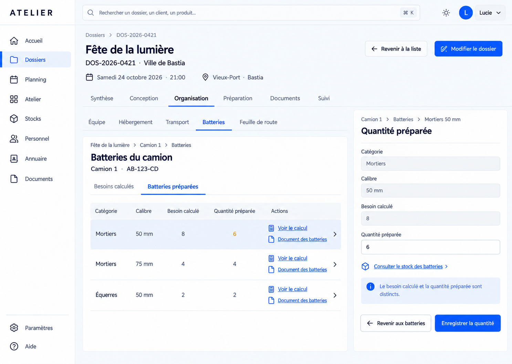

### 18. Feuille de route

**Objectif :** Retrouver les informations utiles à l’intervention.

**Chemin :** Feuille → jour → personne/camion/nuitée → retour ; Consignes → PDF.

**Données et fonctions :** Responsable de tir côté client et téléphone, informations chantier, récupération/retour camion, transport, hôtel ; équipe par jour, transports et nuitées.

**Existant / proposition :** Champs vérifiés dans RouteSheetEditor et RouteSheet ; aucun PDF généré ici.

**Règle à conserver :** Le contact opérationnel n’est pas repris automatiquement du contact général. Le PDF est un document préparé ; pas un envoi. Les cinq zones de consignes restent disponibles, même repliées.

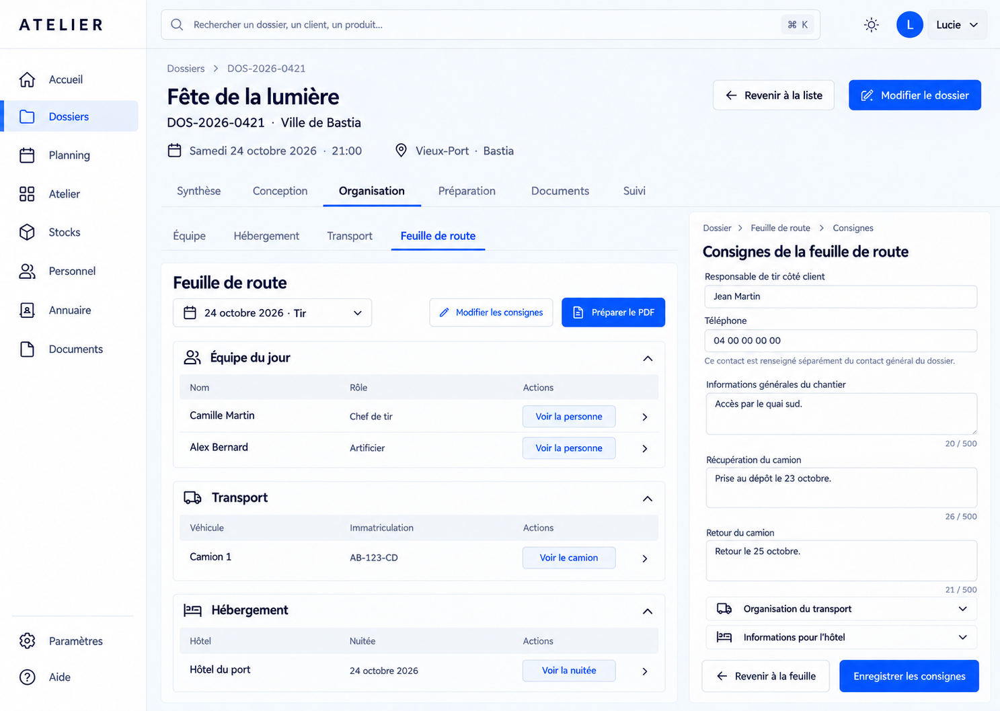

### 19. Documents du dossier

**Objectif :** Retrouver les pièces et leur historique.

**Chemin :** Documents → document → fichier / nouvelle version / archive → retour.

**Données et fonctions :** Pièces privées, titre, catégorie, dates, versions, notes et archives ; PDF générés et leur état.

**Existant / proposition :** Fonctions de documents du dossier relues. Ne pas confondre avec Documents du client, dont l’ouverture provoque le blocage de droit trouvé.

**Règle à conserver :** Téléchargement seulement quand le fichier est prêt et autorisé. L’historique des versions est métier : il reste visible. Les documents en cours, en erreur et prêts ont des actions distinctes. Aucun téléchargement ni dépôt réel effectué.

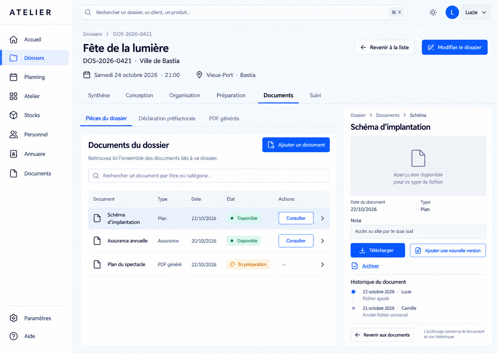

### 20. Rapport après prestation

**Objectif :** Consigner le déroulement et les retours client.

**Chemin :** Suivi → Rapport de tir → champs conditionnels → enregistrer → commentaires.

**Données et fonctions :** Tir effectué, incident/annulation, problème technique, durée prévue/respectée/réelle, blancs et raisons, client contacté, avis et autres retours.

**Existant / proposition :** Champs vérifiés dans ShootingReportEditor ; pas de rapport enregistré dans cette session.

**Règle à conserver :** Durée réelle obligatoire si la durée prévue n’est pas respectée. Le rapport ne clôture pas automatiquement le dossier et ne déclenche pas de mouvement de stock. L’image représente le 25 octobre, après l’événement fictif.

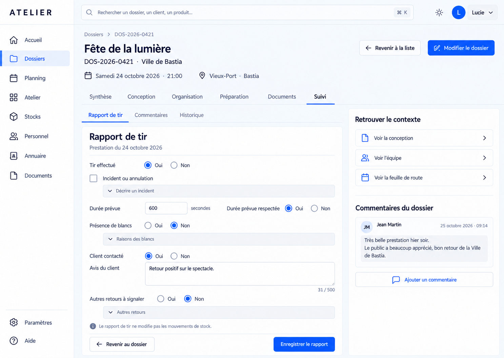

### 21. Historique et retour au dossier

**Objectif :** Comprendre qui a changé quoi.

**Chemin :** Suivi → Historique → événement → avant/après → objet concerné → retour.

**Données et fonctions :** Auteur, date, valeurs avant/après et accès à l’objet concerné. Commentaires dans leur rubrique propre.

**Existant / proposition :** Historique présent. Regroupement, filtres, pagination et panneau de détail proposés ; pas de test de ces nouvelles interactions.

**Règle à conserver :** Historique en lecture seule, sans bouton annuler arbitraire. Les changements de contacts et référentiels restent dans leurs journaux propres lorsque l’agrégation actuelle ne les inclut pas. Les chiffres sont illustratifs.

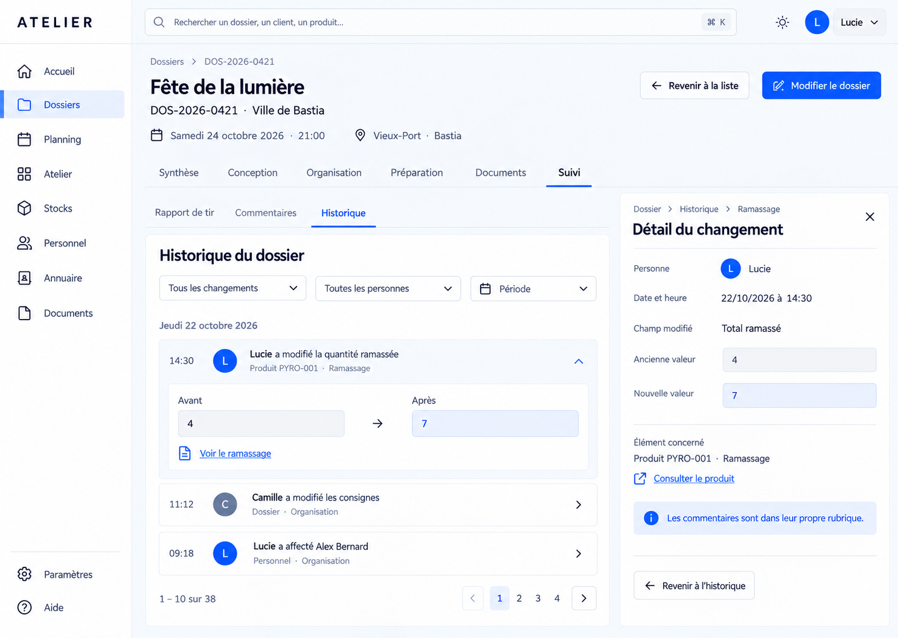

